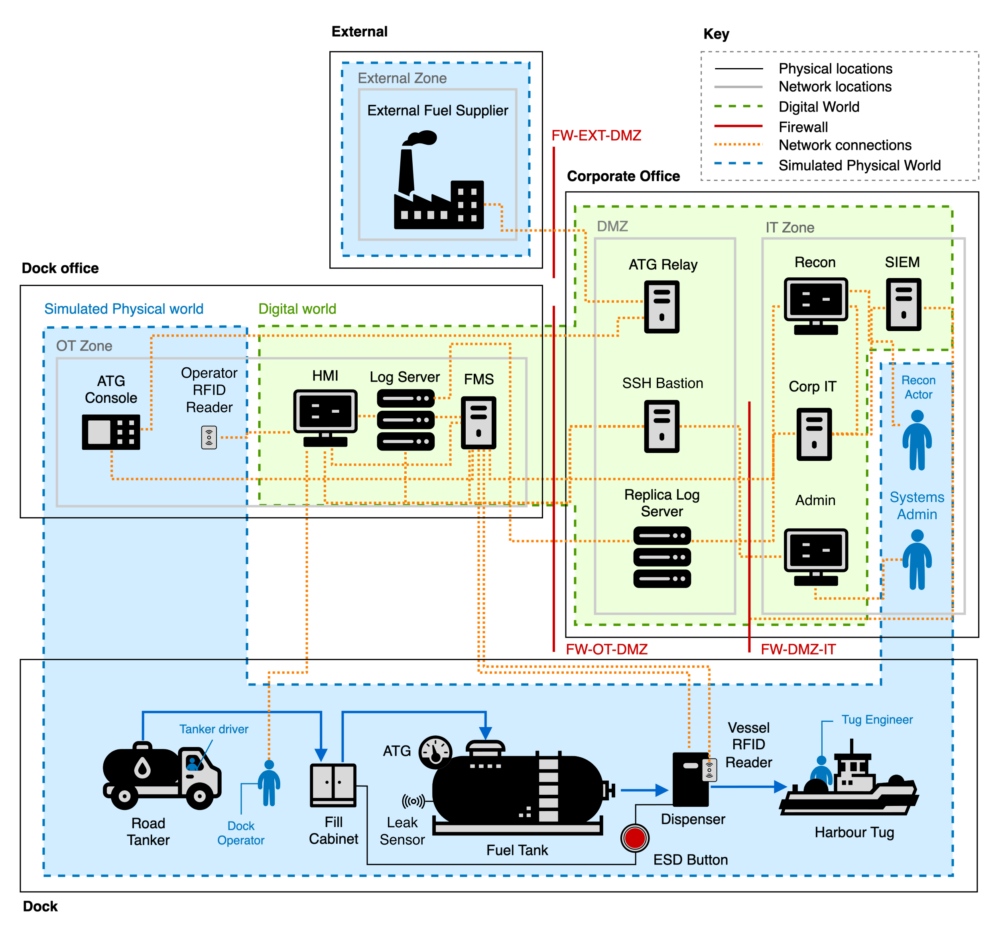

<h1 align="center">
  <picture>
    <source media="(prefers-color-scheme: dark)" srcset="docs/images/ravensport-logo-dark.svg">
    <source media="(prefers-color-scheme: light)" srcset="docs/images/ravensport-logo.svg">
    
  </picture>
</h1>

An official competition at [IEEE SaTML 2027](https://satml.org/competitions/). RavensPort is co-organised by the [AI for Cyber Defence (AICD)](https://www.turing.ac.uk/research/research-projects/ai-cyber-defence-research-centre-aicd) research centre at The Alan Turing Institute and the United Kingdom's National Cyber Security Centre (NCSC).

**RavensPort** invites participants to defend a realistic critical infrastructure network, running real software on virtualised hosts, as multi-stage attacks unfold. Entrants collect live host and network data with their own tooling and must autonomously detect and mitigate attacks, including methods withheld until final scoring. The competition asks two questions, the first in Track A and the second in Track B:

- _How much warning can machine learning give before an attack on critical infrastructure takes effect?_

- _Can an autonomous agent mitigate live attacks without disrupting operations?_

___

## Dates and contact

- The competition closes on 19 February 2027.
- Submission details and Track B release coming soon!
- Questions go to [ravensport@turing.ac.uk](mailto:ravensport@turing.ac.uk)

## The port

RavensPort is a large fictional shipping port on the British coastline. The port's tugs refuel at a small fuel facility with one on-shore tank, which an external fuel supplier refills by road tanker. A dock operator handles each delivery and each refuel, and transcribes their paper records into the dock's digital system. At the end of each audit period, the reconciliation user compares the paper records with the digital records. [`narrative.md`](narrative.md) describes the port, its people and processes, and the conditions under which the port operates correctly.

<p align="center">
  
</p>

The testbed comprises two worlds. A simulator models the physical world, from the tank and its fuel to the paper documents and the people. The simulator also runs the port's sealed devices, such as the tank gauge console and the dispenser. The digital world runs the software that the port's own staff deploy, such as the fuel management system, the log server, the firewalls and the security monitoring. Incus runs each host of the digital world as a container or a virtual machine.

The security monitoring host, `siem-01`, gathers alerts and records from agents on the port's hosts and from inspection of the traffic between the port's network zones. A separate adversary host launches each attack.

## The challenge in Track A

In Track A, an entry raises the Track A alarm as early as possible in an adversarial episode, and never in a benign one.

An episode is one scored run of the port, of at most 144 steps of 5 seconds. A benign episode holds the port's operation alone, and an adversarial episode adds one attack chain, the ordered stages of one attack, run as one program on the adversary host. In scoring, each episode runs in a fork of a living port. A living port is a deployment of RavensPort that runs continuously. A fork copies the living port's whole state at one instant into a virtual machine of its own. Every host of a fork therefore holds the records of the port's operation since the living port's deployment.

At each step, the entry's defender, a program on `siem-01`, reads the security monitoring through the query interface, `siem-read`, and answers no action or the Track A alarm. An entry comprises four parts.

- **A modified `siem-01`.** The entry's storage volume, which `siem-01` mounts at `/var/lib/entry` and which holds the defender's program, `defender`. The entry may also give its own image of `siem-01`.
- **Added host tooling.** Any software that the entry adds to other hosts of the digital world, built into each host's image.
- **A telemetry specification.** The declaration of the data that the entry reads.
- **Self-reported performance.** The scores that the entrant measured in its own episodes in evaluation mode, the mode of final scoring, in which the storage volume is read-only.

The episode runner, the program that runs and scores each episode, starts the attack chain at a step from 6 to 24 and releases its stages one at a time. Each episode's reward, `R_n`, depends on when the Track A alarm arrives. `K` is the number of stages of the episode's attack chain, and `k_n` the number of stages released before the Track A alarm.

| Episode | Track A alarm | `R_n` |
|---|---|---|
| Benign | None | `0` |
| Benign | A false alarm | `-1` |
| Adversarial | Before the release of the first stage, a false alarm | `-1` |
| Adversarial | After `k_n` stages are released, for `k_n` from 1 to `K - 1` | `-(k_n - 1)/(K - 1)` |
| Adversarial | None, a missed attack | `-1` |

A Track A alarm after the first release and before the second scores `0`, the best score of an adversarial episode. An entry's score is the mean of `R_n` over its benign episodes and the mean over its adversarial episodes, weighted by the published proportions of the two types. Final scoring also uses attack methods beyond those in this release.

[The entry guide](docs/entry-guide.md) gives the parts of an entry, the step messages, the query interface, the tooling that an entry may add, the scoring in full and the episode records. Track B, which scores the mitigation of attacks through defensive actions, comes in a later release.

## Getting started

### Requirements

- A Linux or macOS machine that can run a virtual machine with 4 processors, 8 GiB of memory and a 100 GiB disk. The virtual machine, the Incus host, runs Ubuntu 24.04 with Incus, which runs the port's containers and virtual machines. The smallest machine tested is a MacBook Pro with a 6-core Intel Core i7-9750H processor and 16 GiB of memory.
- Lima, which builds and runs the Incus host from [`deploy/lima.yaml`](deploy/lima.yaml) and installs the build tools inside it.
- For training, the Quick Emulator (QEMU) and Python 3 on the machine itself, with the kernel-based virtual machine (KVM) on Linux or Apple's Hypervisor framework on macOS. A living port and its fork each take a virtual machine of 4 processors and 8 GiB of memory by default, and each fork's saved state takes about 8 gigabytes of disk. On the 16 GiB MacBook Pro, a living port and a fork of 6 GiB each (`--memory-mib 6144`) ran a full episode.

### Install

Clone the repository under your home directory, which Lima shares with the Incus host at the same path. Start the Incus host, which takes several minutes the first time, and open a shell in it at the repository's root.

```sh
git clone https://github.com/alan-turing-institute/Ravensport-Competition.git
cd Ravensport-Competition
brew install lima                                  # on macOS
limactl start --name=ravensport deploy/lima.yaml
limactl shell ravensport
```

Inside the Incus host, build the Python environment of the episode runner, and stage the binaries of the attack chains.

```sh
make -C deploy install
make -C deploy stage-attacks
```

The release holds the binaries of the attack chains without their source, under `attack-chains/prebuilt/`. `make -C deploy stage-attacks` copies the binaries for the host's architecture, x86_64 or aarch64, into `attack-chains/dist/` and checks them against their digests. Before it runs adversarial episodes, the episode runner checks that the binaries were built from the reviewed source of the attack chains, and refuses adversarial episodes otherwise ([`episodes.md` §10.1, the competition library](specs/competition/episodes.md#101-the-competition-library)).

To explore the port outside an episode, `make -C deploy up` deploys the port with its operational images, and `make -C deploy down` tears the deployment down. `make -C deploy up` runs `make -C deploy stage-attacks` too. `make -C deploy help` lists every target.

### Example entries

[`competition/baselines/track_a`](competition/baselines/track_a) holds three example entries, each with a `README.md` that gives its method.

- **[`heuristic`](competition/baselines/track_a/heuristic).** Raises the Track A alarm on a Wazuh security alert of severity 8 or above, or on network traffic to or from an address that no host of the port holds.
- **[`learning`](competition/baselines/track_a/learning).** Learns how often each property of the records occurs in benign operation, and raises the Track A alarm at a step whose records show rare properties.
- **[`packetbeat`](competition/baselines/track_a/packetbeat).** Adds Packetbeat, a packet analyser, to its own image of `siem-01`, and raises the Track A alarm when the security monitoring's management interface or enrolment service is used.

Inside the Incus host, `make_volume.py` writes an example's storage volume into an empty directory. The argument `idle` writes an empty volume, from which the launcher runs the idle defender.

```sh
python3 competition/baselines/track_a/make_volume.py heuristic ~/volumes/heuristic
```

[`common/protocol.py`](competition/baselines/track_a/common/protocol.py) implements the step protocol and the reads of the examples. [`common/replay.py`](competition/baselines/track_a/common/replay.py) runs a defender's program over exported episode records, for development alone.

### Run episodes

The episode runner's command `run` deploys a fresh port for each episode, runs the episode at fork 0, on the deployment itself, and tears the deployment down. Start the command inside the Incus host, from the repository's root, with no deployment running. The first episode builds the images, which takes several minutes. The command runs in evaluation mode, with the idle defender unless `--volume` gives an entry's storage volume.

```sh
PY=deploy/.venv-$(uname -s)-$(uname -m)/bin/python
$PY -m competition.episode_runner run --track A                       # one benign episode
$PY -m competition.episode_runner run --track A --type adversarial    # one adversarial episode
$PY -m competition.episode_runner run --track A --episodes 4 --volume ~/volumes/heuristic
```

The command prints the directory of each episode record with the episode's outcome. `--chain NAME` names an attack chain by its binary's name, and `--help` lists every option. An episode at fork 0 starts from the port's default start state, with minutes of history. Living ports give episodes a longer history.

### Train on living ports

Training mode runs only in forks of a living port. Each episode starts from the port's accumulated history. The training volume, a writable version of the entry's storage volume, passes from each episode to the next. The [training guide](docs/training.md) gives the commands, and the preparation of the base disk on Linux and on macOS.

## Competition Rules

Every entry follows the rules below.

- **Competition Rule 1, entries.** Individuals and teams are welcome and may submit more than one entry to either or both tracks.
- **Competition Rule 2, withheld attack methods.** Attack methods withheld during the competition will be released with the final scores for transparency.
- **Competition Rule 3, reads only through the query interface.** An entry reads only the data that its telemetry specification declares, through the query interface. The organisers review each submitted `siem-01`, and contact the entrant before disqualifying an entry for a breach of uncertain intent.
- **Competition Rule 4, added host tooling.** Added host tooling is limited to collecting data on the hosts of the digital world and transmitting it along the collection paths that the entry declares. Any other change to the environment is forbidden.
- **Competition Rule 5, an unchanged environment.** An entry's tooling leaves the environment as the reference deployment runs it, with `siem-01` as released and no entry's tooling. Benign operation stays as it is, and each attack chain reaches the same stages. The organisers check the rule by replaying a sample of evaluation episodes with the entry's images deployed and its defender running, recording each decision and carrying none out.
- **Competition Rule 6, Track B's defensive actions.** Track B submissions must only use the provided defensive actions, which may not be altered in any way.
- **Competition Rule 7, a suspected breach.** Where a submission appears to violate these rules, or the spirit of the competition, we will contact the entrant and seek to resolve the matter before declaring the entry invalid.
- **Competition Rule 8, the reward.** The reward signal may be used during training, for optimisation, but must not be used for inference during evaluation.
- **Competition Rule 9, the adversary host.** No entry may change the adversary host.

## Documentation

| Document | Contents |
|---|---|
| [`docs/entry-guide.md`](docs/entry-guide.md) | Writing an entry for Track A: the parts of an entry, the step messages, the query interface, added tooling, scoring and the episode records |
| [`docs/training.md`](docs/training.md) | Training on living ports, and the preparation of the base disk |
| [`specs/competition/episodes.md`](specs/competition/episodes.md) | Episodes, living ports and forks, the step protocol, the query interface, scoring and the Competition Rules |
| [`specs/competition/episode-runner-impl.md`](specs/competition/episode-runner-impl.md) | The step messages, the query interface and the episode record in detail |
| [`narrative.md`](narrative.md) | The fictional port, its people and its processes |
| [`specs/digital.md`](specs/digital.md) and [`specs/sim.md`](specs/sim.md) | The digital world and the simulator |
| [`specs/host_specs/siem/siem.md`](specs/host_specs/siem/siem.md) | The security monitoring and the records it produces |
| [`docs/testbed.md`](docs/testbed.md) | The testbed's design, deployment profiles and tests |

The entry requirements, the ratio of benign to adversarial episodes and the number of episodes await publication, with measured values in place of this release's provisional values, such as the compression factor. The known limitations of this release, and the parts that await specification, are listed in [`episodes.md` §18 (limitations)](specs/competition/episodes.md#limitations) and [`episodes.md` §19 (open items)](specs/competition/episodes.md#open-items).

## Data terms and privacy

RavensPort runs under conditions set by the IEEE SaTML 2027 programme chairs, which the organisers have accepted. The conditions are the Data Terms and Privacy Notice in [`TERMS.md`](TERMS.md).

## Licence

This repository is released under the MIT Licence. See [`LICENSE`](LICENSE).
